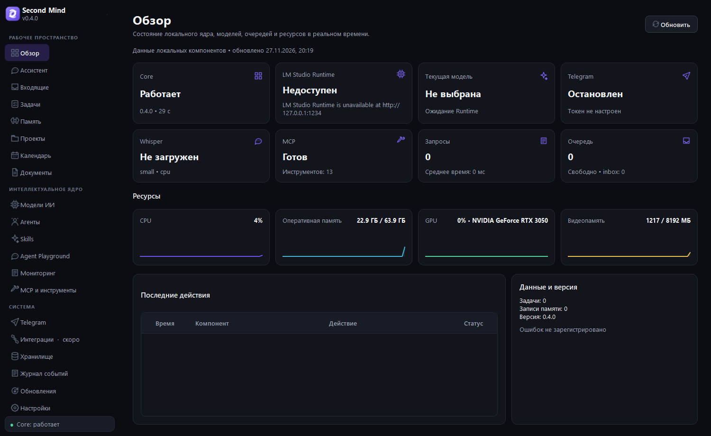
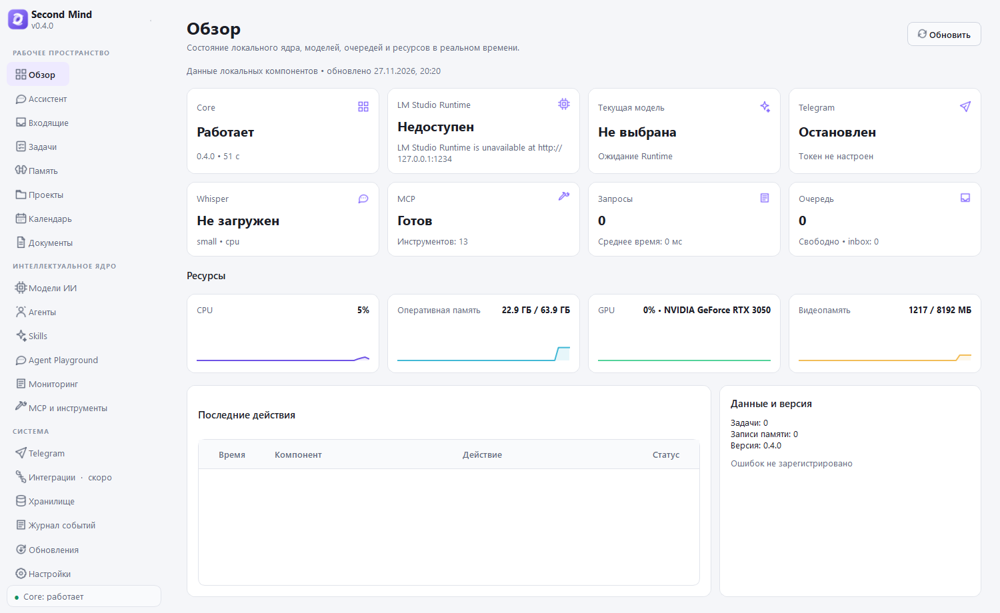
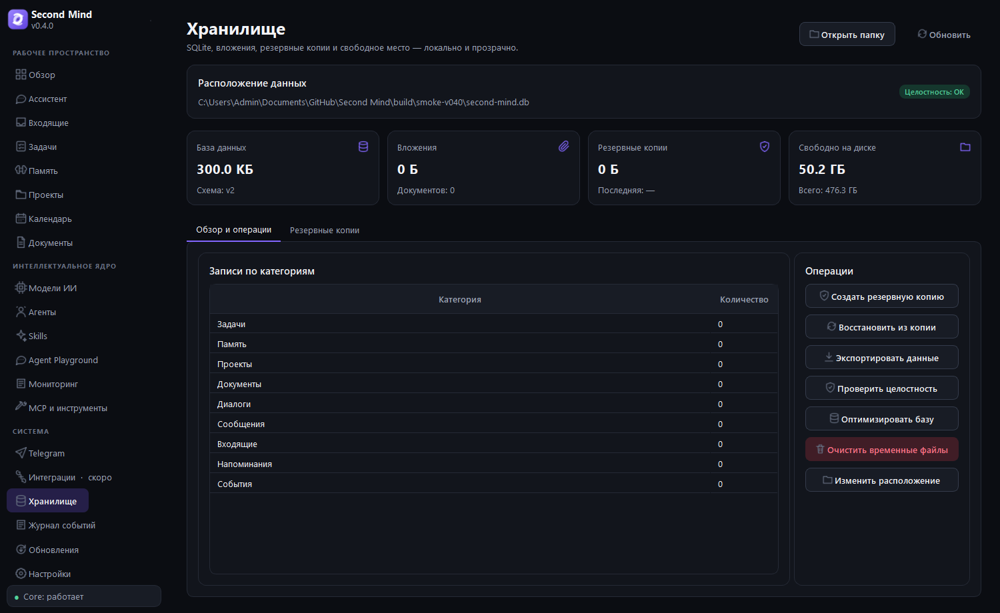
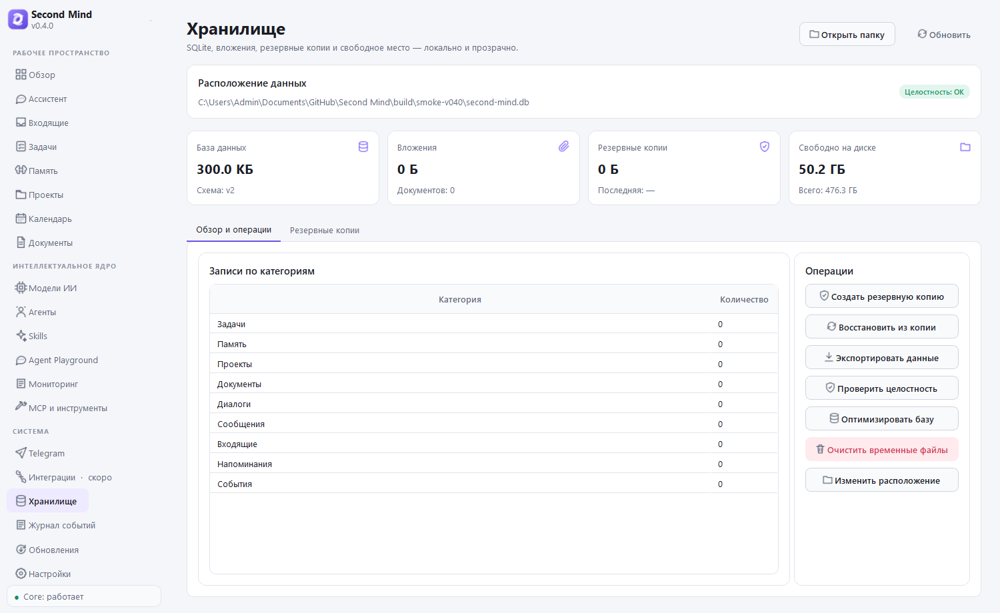
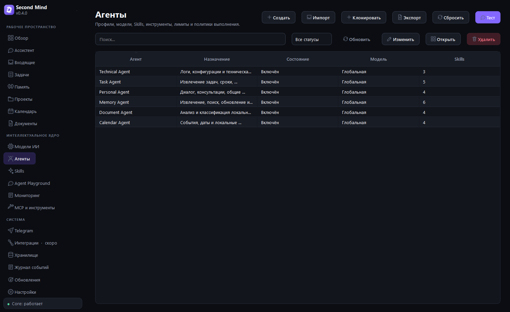
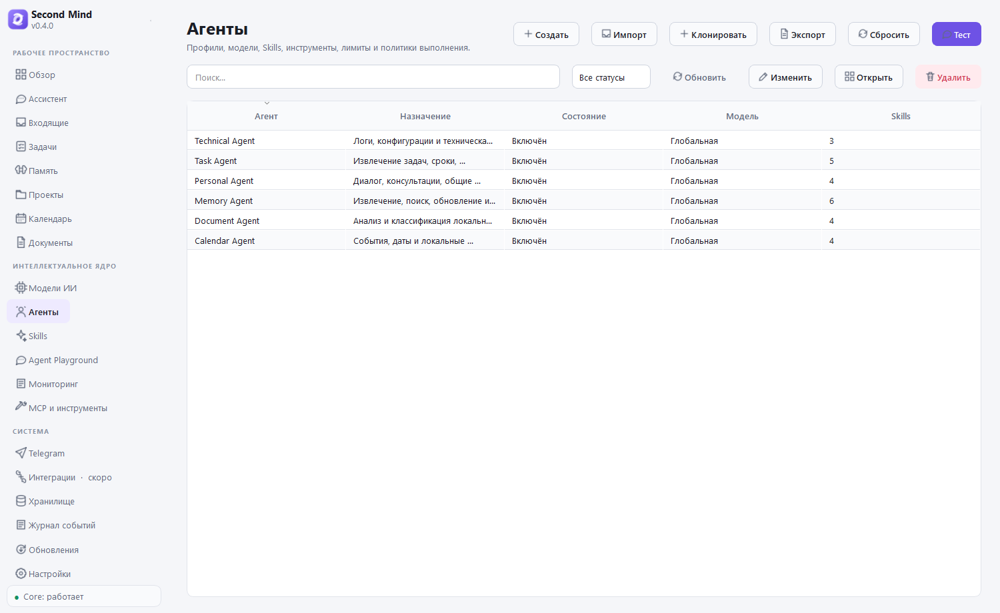
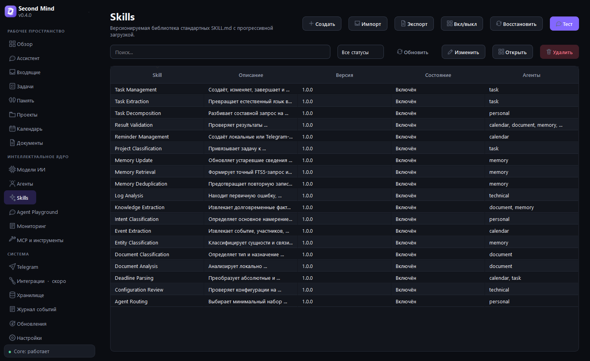
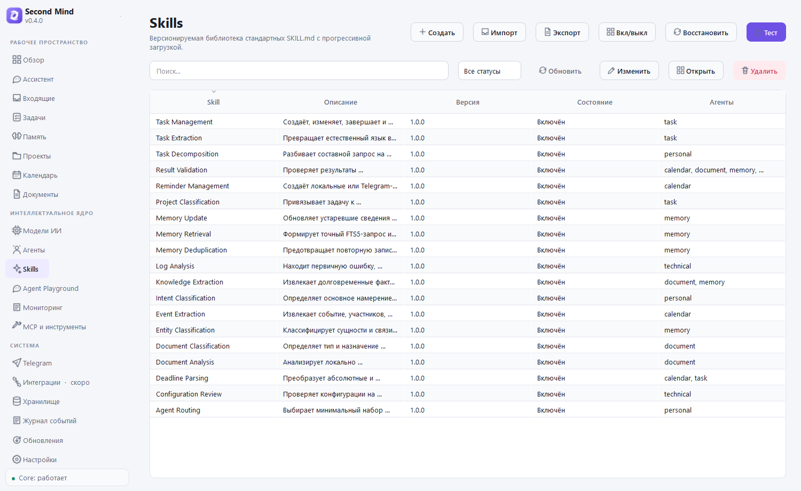

# Second Mind

Second Mind is a local-first personal AI assistant for Windows. It combines an independent Core service, a modern PySide6 desktop application, Telegram, durable memory, tasks, document processing, local speech recognition and an MCP server.

[Русская документация](README.md) · [Architecture](docs/architecture.md) · [Storage](docs/storage.md) · [Roadmap](ROADMAP.md) · [Security](SECURITY.md)

## Version 0.4.0

Version 0.4.0 adds a persistent Agent Engine, six configurable profiles, standard Agent Skills, backend tool policies, an Agent Playground and factual execution monitoring on top of one shared local LM Studio Runtime.

| Dark | Light |
| --- | --- |
|  |  |
|  |  |
|  |  |
|  |  |

## Highlights

- Grouped, collapsible navigation and a compact live Core indicator.
- Non-blocking Dashboard with real Core, LM Studio, model, Telegram, Whisper, MCP, CPU, RAM, GPU, VRAM, queue, request and error data.
- Assistant history, Markdown and code rendering, copy actions, attachments, processing stages and transparent tool calls.
- Sequential orchestrator with deterministic routing, bounded context, relevant Skills, retries, timeouts, action limits and cancellation.
- Personal, Memory, Task, Calendar, Document and Technical agents with persistent GUI configuration and import/export.
- Nineteen versioned standard `SKILL.md` files, progressive disclosure and user overrides stored outside program files.
- Backend-enforced `auto`, `confirm` and `deny` policies, strict schemas, Dry Run, approvals and tool-call history shared by Desktop, Telegram and MCP.
- Agent Playground and run monitoring without exposing hidden model reasoning.
- Search, filtering, sorting, record views and CRUD for tasks, memory, projects, documents, inbox and reminders.
- Real LM Studio model discovery, Telegram connection test and Whisper lifecycle controls.
- SQLite Backup API support that is safe with WAL, scheduled backups, retention, integrity checks, export, restore, optimization, cleanup and staged storage relocation.
- Windows Credential Manager secrets; plain-text backup and export files never include tokens.
- Ed25519/SHA-256 verified updates with application/database backup, health validation and rollback.

## Windows installation

Download `Second-Mind-Setup-0.4.0.exe` from [GitHub Releases](https://github.com/markKikhtenko/second-mind/releases). Python is not required. Setup bundles Core, Desktop, MCP, the Skill library, the detached updater and runtime dependencies, and creates correctly branded Start menu and optional desktop shortcuts.

Program files are installed per user. Data remains under `%LOCALAPPDATA%\Second Mind\Second Mind`, so normal reinstall and uninstall preserve the database, attachments and settings.

## Development

```powershell
py -3.12 -m venv .venv
.\.venv\Scripts\Activate.ps1
python -m pip install -e ".[desktop,speech,dev]"
second-mind-desktop
```

LM Studio Runtime 0.4+ should listen on `http://127.0.0.1:1234`. The desktop starts Core as a detached process; closing the window keeps Core and Telegram available.

Run `ruff check .` and `pytest --cov=second_mind`. Build Windows artifacts with `packaging\build.ps1`. The release workflow additionally validates a clean installation, a real detached-updater transaction and an upgrade from the previous stable release while preserving data and settings.

Licensed under Apache-2.0.
