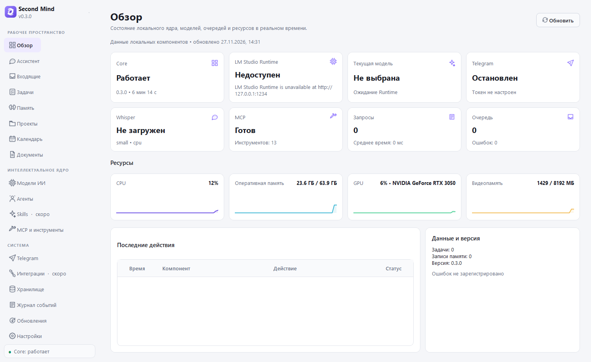
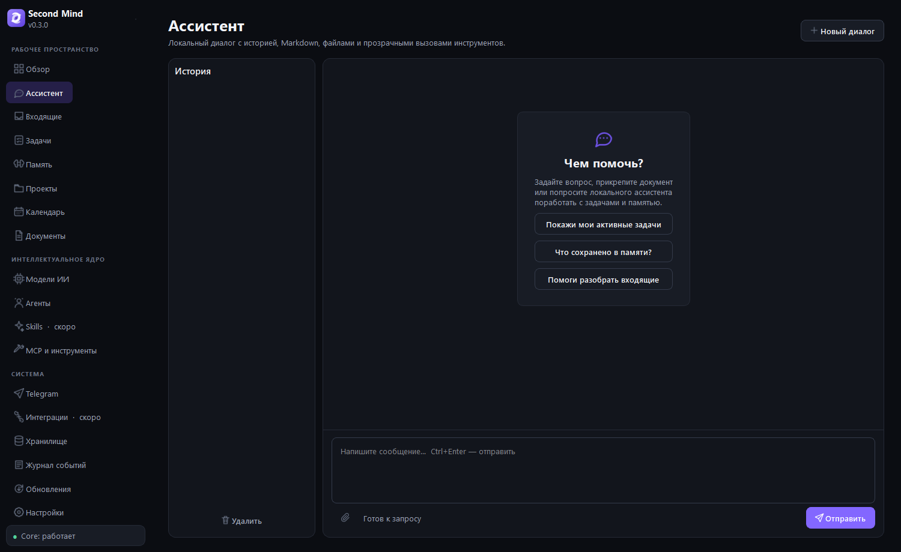

# Second Mind

Локальный персональный ИИ-ассистент для Windows: фоновый Core, современный desktop-интерфейс, Telegram, долговременная память, задачи, документы, локальная речь и MCP.

[English documentation](README.en.md) · [Архитектура](docs/architecture.md) · [Хранилище](docs/storage.md) · [Roadmap](ROADMAP.md) · [Безопасность](SECURITY.md)

> Актуальная версия: **0.3.0**. Релиз добавляет единую дизайн-систему, полностью русскоязычный PySide6 GUI, новый Dashboard и ассистент, управление пользовательскими данными и полноценный менеджер локального SQLite-хранилища. Возможности следующих этапов явно помечены как «Скоро» и не имитируют работу.

## Интерфейс

| Тёмная тема | Светлая тема |
| --- | --- |
|  |  |
|  |  |
|  |  |

Светлая, тёмная и системная темы используют общие токены цвета, типографики, размеров, отступов и скруглений. SVG-иконки, собственный знак Second Mind и High DPI-настройки одинаково применяются в приложении, трее, установщике и ярлыках Windows.

## Возможности

- Независимый Core на FastAPI, доступный только через loopback, с запуском, остановкой и перезапуском из GUI.
- Сгруппированная сворачиваемая навигация, активные состояния и компактный индикатор Core.
- Dashboard с реальными статусами Core, LM Studio, выбранной LLM, Telegram, Whisper и MCP, а также CPU, RAM, GPU, VRAM, очередью, ошибками и версией.
- Современный ассистент с историей диалогов, Markdown, кодом, копированием ответа, вложениями и отображением этапов и вызовов инструментов.
- Поиск, фильтрация, сортировка, карточки и CRUD для задач, памяти, проектов, документов, входящих и календарных напоминаний.
- Получение фактического списка моделей через LM Studio API, проверка Telegram и управление жизненным циклом Whisper.
- SQLite WAL, миграции, FTS5, дедупликация и локальные вложения.
- Storage Manager: метрики, `integrity_check`, безопасный `VACUUM`, очистка временных файлов, экспорт, перенос хранилища, резервные копии и восстановление.
- Telegram allowlist, long polling, персистентный inbox и защита от повторной обработки.
- MCP-инструменты для задач, памяти, заметок, проектов, напоминаний и документов.
- Секреты в Windows Credential Manager; открытые экспорт и backup не содержат токены.
- Подписанные обновления с SHA-256, Ed25519, backup, health-check и автоматическим откатом.

## Установка Windows

Скачайте `Second-Mind-Setup-0.3.0.exe` из [GitHub Releases](https://github.com/markKikhtenko/second-mind/releases). Python и командная строка не нужны: установщик включает Core, Desktop, MCP, updater и runtime-зависимости.

Установщик создаёт ярлык в меню «Пуск», предлагает ярлык рабочего стола и автозапуск Core. Программа устанавливается для текущего пользователя, а данные находятся отдельно в `%LOCALAPPDATA%\Second Mind\Second Mind`, поэтому обычная переустановка или удаление приложения их не стирает.

## Хранилище и резервные копии

Раздел «Хранилище» показывает расположение и схему БД, размеры SQLite, вложений и резервных копий, количество записей, свободное место, целостность и дату последнего backup.

Резервная копия создаётся через SQLite Backup API и остаётся консистентной при включённом WAL. Архив включает базу, конфигурацию без секретов и пользовательские вложения. Восстановление, перенос и удаление временных данных требуют подтверждения; перенос выполняется через промежуточный каталог и проверку целостности. Расписание и срок хранения backup настраиваются в GUI. Подробности: [docs/storage.md](docs/storage.md).

## Обновления и восстановление

Существующий механизм v0.2 сохранён. Отдельный updater повторно проверяет подпись и SHA-256, останавливает процессы, создаёт резервную копию приложения и SQLite, устанавливает новую версию и проверяет точную версию Core. Если установка или health-check не проходят, предыдущая версия и база автоматически восстанавливаются.

Журнал транзакции находится в `%LOCALAPPDATA%\Second Mind\Second Mind\updates\update.log`. CI проверяет чистую установку, отдельную updater-транзакцию и обновление с предыдущего стабильного релиза с сохранением данных и настроек.

## Запуск для разработки

Требования: Windows 10/11, Python 3.11–3.14, LM Studio Runtime 0.4+ или совместимый локальный API.

```powershell
py -3.12 -m venv .venv
.\.venv\Scripts\Activate.ps1
python -m pip install -e ".[desktop,speech,dev]"
second-mind-desktop
```

GUI запускает Core отдельным фоновым процессом. Swagger доступен только локально по `http://127.0.0.1:8765/docs`.

## Настройка

1. В LM Studio включите Local Server на `http://127.0.0.1:1234` и загрузите модель с tool-use.
2. Запустите `second-mind-desktop` и пройдите мастер.
3. Для Telegram укажите token BotFather и собственный числовой User ID; пустой allowlist блокирует запуск бота.
4. Выберите Whisper-модель и вычислительное устройство. Загрузка выполняется только после явного действия.
5. Проверьте реальные статусы на странице «Обзор».

## MCP

```json
{
  "mcpServers": {
    "second-mind": {
      "command": "C:\\path\\to\\second-mind-mcp.exe"
    }
  }
}
```

Для dev-установки используйте `python -m second_mind.mcp_server`. Актуальную конфигурацию возвращает `GET /api/mcp/config`.

## Проверка и сборка

```powershell
ruff check .
pytest --cov=second_mind
.\packaging\build.ps1
```

Build создаёт Core, Desktop, MCP, отдельный updater и единый Inno Setup installer. Release workflow повторяет тесты, установочные сценарии, подпись метаданных и публикацию GitHub Release.

Лицензия: Apache-2.0.
