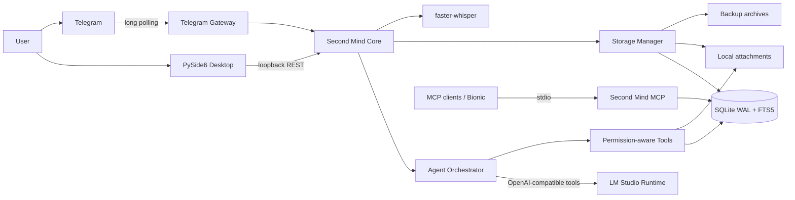
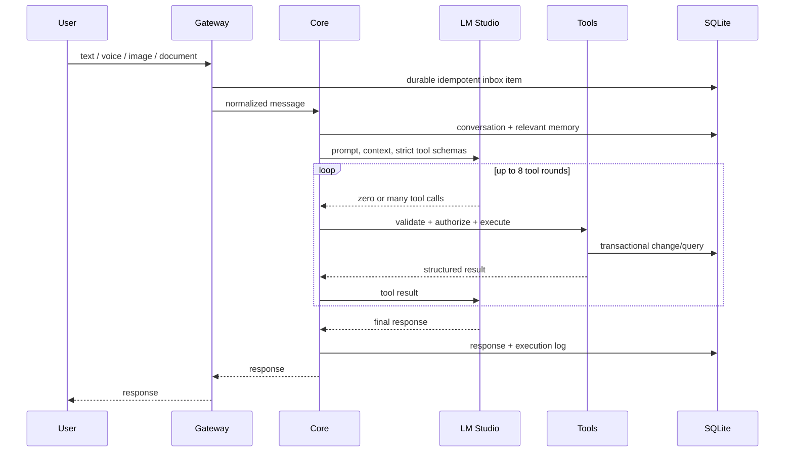

# Architecture

Second Mind is a modular monolith with separate Core and GUI processes. This avoids premature microservices while keeping bot availability independent from the window lifecycle.

## Modules

- `api.py`: loopback control plane and GUI contract.
- `desktop.py`: design-system based GUI, setup wizard, tray lifecycle and operational screens.
- `ui_theme.py`: theme tokens, scalable SVG icons and reusable visual components.
- `telegram_gateway.py`: allowlist, idempotent inbox and media ingestion.
- `llm.py`: supported LM Studio API adapter.
- `services.py`: orchestration, speech, documents, scheduler and backup.
- `tools.py`: schemas, permissions and business tool execution.
- `repositories.py`: persistence boundary.
- `storage.py`: WAL-safe backup, restore, export, integrity, optimization and relocation.
- `mcp_server.py`: stdio MCP exposure of the same business tools.

## Request sequence

## Data model

IDs are UUIDs. Timestamps are UTC ISO-8601. SQLite uses foreign keys, WAL and a busy timeout. FTS5 indexes memory and extracted document text. Normalized SHA-256 hashes deduplicate memory and attachments. Inbox `(transport, external_id)` uniqueness prevents repeated effects after polling retries.

The Storage Manager uses SQLite's online Backup API rather than copying live database files. Backup archives contain a consistent database snapshot, sanitized configuration and attachments. Restore validates archive paths and database integrity, and relocation stages a verified copy before switching configuration.

## Failure behavior

- LM Studio unavailable: chat returns 503; tasks, memory, files and GUI remain usable.
- Telegram unavailable: Core remains healthy and records the error.
- Whisper missing/model load failure: text path remains usable and GUI shows the error.
- Duplicate Telegram update: previously processed inbox item is ignored.
- Tool validation failure: result is returned to the model as an error; no mutation occurs.
