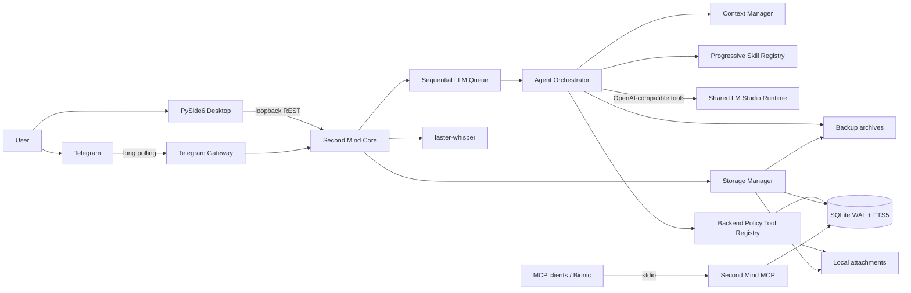
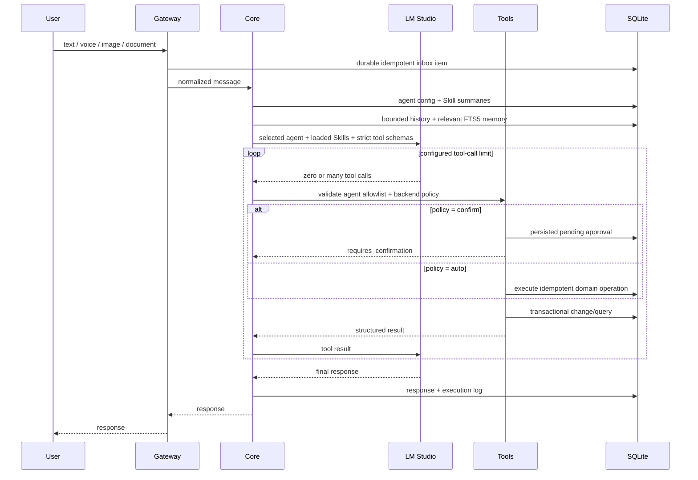

# Architecture

Second Mind is a modular monolith with separate Core and GUI processes. This avoids premature microservices while keeping bot availability independent from the window lifecycle.

## Modules

- `api.py`: loopback control plane and GUI contract.
- `desktop.py`: design-system based GUI, setup wizard, tray lifecycle and operational screens.
- `ui_theme.py`: theme tokens, scalable SVG icons and reusable visual components.
- `telegram_gateway.py`: allowlist, idempotent inbox and media ingestion.
- `llm.py`: supported LM Studio API adapter.
- `agent_engine.py`: persistent agent/Skill registry, routing, bounded context, policies, approvals and run traces.
- `services.py`: sequential orchestration, cancellation, speech, documents, scheduler and backup.
- `tools.py`: strict schemas, agent allowlists, backend policies, Dry Run, timeouts and business execution.
- `repositories.py`: persistence boundary.
- `storage.py`: WAL-safe backup, restore, export, integrity, optimization and relocation.
- `mcp_server.py`: stdio MCP exposure of the same business tools.

## Request sequence

## Data model

IDs are UUIDs. Timestamps are UTC ISO-8601. SQLite uses foreign keys, WAL and a busy timeout. FTS5 indexes memory and extracted document text. Normalized SHA-256 hashes deduplicate memory and attachments. Inbox `(transport, external_id)` uniqueness prevents repeated effects after polling retries.

Migration 2 adds `agent_configs`, `skills`, `agent_skills`, `tool_policies`, `tool_call_history`, `tool_approvals` and `agent_runs`. Built-in definitions are seeded without overwriting user edits. Custom Skills and overrides are also mirrored under the user data directory, outside application files.

The Context Manager budgets prompt size by source priority: system safety rules, selected agent configuration, at most four relevant Skills, current user input, relevant FTS5 memory and the newest conversation history that fits. It never sends the complete knowledge base or all agent prompts/Skills. Embeddings and vector retrieval remain deferred to v0.5.

All agents share one LM Studio Runtime provider. The default `asyncio.Lock` serializes inference so configuring more agents does not load more model instances. Simple slash commands bypass the model; deterministic routing does not add a classification LLM call.

The Storage Manager uses SQLite's online Backup API rather than copying live database files. Backup archives contain a consistent database snapshot, sanitized configuration, agent/Skill state and attachments. Restore validates archive paths and database integrity, and relocation stages a verified copy before switching configuration.

## Failure behavior

- LM Studio unavailable: chat returns 503; tasks, memory, files and GUI remain usable.
- Telegram unavailable: Core remains healthy and records the error.
- Whisper missing/model load failure: text path remains usable and GUI shows the error.
- Duplicate Telegram update: previously processed inbox item is ignored.
- Tool validation failure: result is returned to the model as an error; no mutation occurs.
- Tool policy denial: backend rejects execution even if a prompt or document asks for it.
- Confirmation required: a persisted approval id is returned; Desktop or Telegram may approve/deny it.
- Agent timeout or tool-call limit: the run is finalized as `timeout` or `limited` with no hidden retry loop.
- Cancellation: the active asyncio task is cancelled and the run journal records `cancelled`.

## Trust boundaries

- Core, Desktop and MCP are local processes; the API binds to loopback.
- LM Studio receives only the bounded request context and selected tool schemas.
- Memory, documents, attachments and forwarded text are wrapped as untrusted evidence.
- Prompts can recommend actions but cannot change agent allowlists or `auto/confirm/deny` policies.
- No general shell, arbitrary filesystem or computer-control tool is registered for agents.
- Bionic compatibility uses standard Agent Skills and the public MCP/LM Studio interfaces only.
